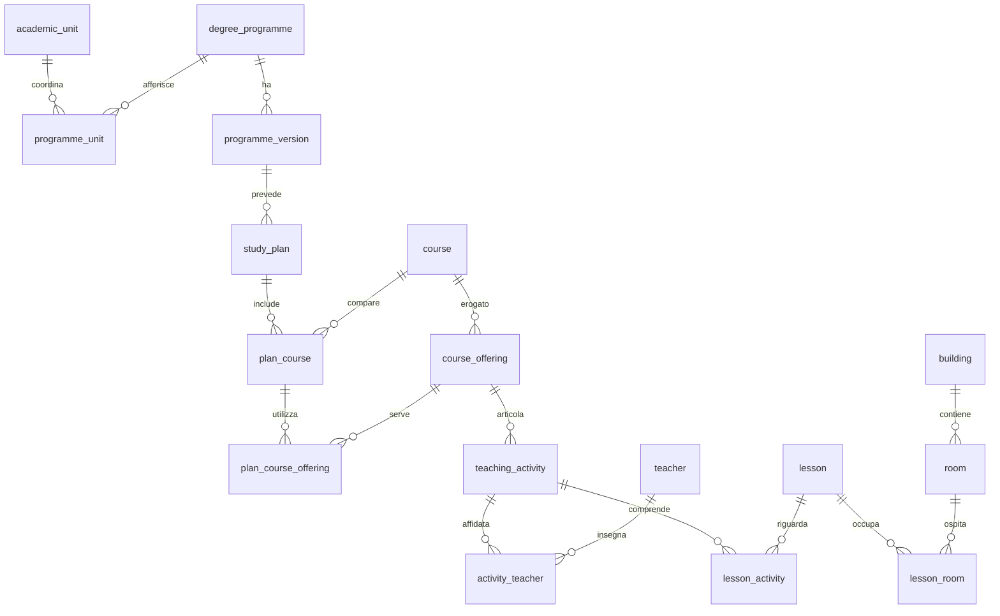

# Proposta di raccolta e modello relazionale

**Aggiornamento:** la raccolta descritta è stata realizzata. Per lo stato effettivo
del database, i conteggi e i limiti consultare [Copertura del dataset](dataset.md).
Lo schema implementato aggiunge `activity_audience` per i destinatari dell'agenda
e `calendar_closure` per le sospensioni didattiche. Il testo seguente conserva lo
studio iniziale, incluse le difficoltà di accesso poi risolte durante la raccolta.

Ricognizione del 20 settembre 2026. Le scelte seguenti sono una proposta; i dati
indicati come osservati provengono dalle fonti pubbliche collegate. Nessun totale
di copertura dell'ateneo è dichiarato già raggiunto.

## 1. Perimetro consigliato

Un singolo file SQLite per fotografia, con un solo anno accademico di riferimento.
Propongo **2026/2027**, già presente nel catalogo e nell'Agenda Web. In prima battuta:

| Livello | Copertura proposta |
| --- | --- |
| Facoltà e scuole | Tutte le strutture didattiche pertinenti al catalogo delle lauree |
| Corsi di laurea | Tutte le triennali, magistrali e magistrali a ciclo unico, comprese le versioni in esaurimento con didattica attiva |
| Insegnamenti | Tutte le attività previste dai piani pertinenti a Informatica triennale e Fisica triennale, su tutti gli anni di corso |
| Edizioni e docenti | Le edizioni effettivamente erogate nel 2026/2027 dei due corsi pilota, compresi gruppi e laboratori |
| Orari e aule | Prima la settimana 21–27 settembre 2026; poi tutte le date pubblicate del primo semestre per entrambi i corsi |

Master, dottorati, specializzazioni e formazione insegnanti restano fuori dal primo
catalogo. Eventuali insegnamenti liberamente selezionabili nell'intero ateneo non
implicano importare l'intero ateneo: si raccolgono le opzioni esplicitamente elencate
nei piani pilota e si conserva il testo delle regole di scelta libera.

La finestra della prima settimana è una proposta per avere presto un calendario
utilizzabile. Il resto del semestre si aggiunge dopo aver verificato la copertura:
non tutti i laboratori iniziano la prima settimana e non tutto il futuro è già pubblicato.

## 2. Dove ottenere i dati

### Catalogo e organizzazione

Fonti di partenza:

- [Elenco ufficiale delle facoltà e scuole](https://www.unimi.it/it/ateneo/uffici-e-strutture/facolta-e-scuole-elenco).
- [Lauree triennali e magistrali a ciclo unico](https://www.unimi.it/it/corsi/corsi-di-laurea-triennali-e-magistrali-ciclo-unico).
- [Lauree magistrali](https://www.unimi.it/it/corsi/corsi-di-laurea-magistrale).
- [Scienze e Tecnologie](https://www.unimi.it/it/corsi/facolta-e-scuole/scienze-e-tecnologie)
  e relative aree di studio, utili per associare i corsi alla struttura.

L'elenco istituzionale consultabile nei risultati indicizzati comprende
Giurisprudenza; Medicina e Chirurgia; Medicina Veterinaria; Scienze Agrarie e
Alimentari; Scienze del Farmaco; Scienze e Tecnologie; Scienze Politiche, Economiche
e Sociali; Scuola di Scienze della Mediazione Linguistica e Culturale; Scuola di
Scienze Motorie; Studi Umanistici. Contiene anche CFI: non va importato
automaticamente come facoltà di laurea. Il censimento finale dovrà verificare le
schede delle strutture e il catalogo, non semplicemente contare tutti i link.

**Facoltà/scuola e dipartimento sono entità distinte.** Una struttura coordina la
didattica; più dipartimenti possono parteciparvi. Manteniamo il tipo della struttura
e relazioni molti-a-molti con le lauree. Gli interateneo si registrano come tali,
con atenei partner descritti nelle note: non occorre importare i loro interi cataloghi.

Strategia: attraversare gli elenchi completi, gestire paginazione e filtri, seguire
le schede, recuperare codice, denominazione, livello, durata, CFU, lingua, sede,
stato e URL ufficiale. Incrociare il risultato con gli elenchi delle facoltà e con
gli orari; gli orari da soli non dimostrano la completezza del catalogo.

### Piani, insegnamenti e docenti

| Fonte | Informazioni da estrarre |
| --- | --- |
| [Piano di Informatica](https://informatica.cdl.unimi.it/it/insegnamenti/piano-didattico) e [scheda centrale](https://www.unimi.it/it/corsi/laurea-triennale/informatica) | Manifesti, coorti, curriculum, anno di corso, obbligatorietà e alternative |
| [Piano di Fisica](https://fisica.cdl.unimi.it/it/insegnamenti/piano-didattico) | Stessa struttura; fonte HTML funzionante durante la ricognizione |
| [A–Z Informatica](https://informatica.cdl.unimi.it/it/insegnamenti/elenco-insegnamenti-z) e [A–Z Fisica](https://fisica.cdl.unimi.it/it/insegnamenti/elenco-insegnamenti-z) | Elenco di controllo delle attività per anno accademico e coorte |
| Schede dei singoli insegnamenti collegate dai piani | CFU, ore, SSD, lingua, obiettivi, programma, prerequisiti, esame, moduli, edizioni e docenti |
| Manifesti PDF collegati dalle pagine | Fonte alternativa e confronto con il piano HTML |
| Profili istituzionali dei docenti | Identità, URL ed eventuale email istituzionale |

Esempio reale: la [scheda di Analisi matematica 1 per Fisica 2026/2027](https://www.unimi.it/it/corsi/insegnamenti-dei-corsi-di-laurea/2027/analisi-matematica-1-6)
indica 8 CFU, 80 ore, SSD MATH-03/A e distingue gruppi/docenti. È una prova che
un unico campo `professore` nell'insegnamento sarebbe insufficiente.

**Problemi osservati:** A–Z Informatica mostra un errore relativo al valore `1285`
del selettore anno; il piano sul sito del corso restituisce nessun risultato.
La selezione esplicita del valore `1505`, letto dall'HTML per il 2026/2027, non ha
restituito l'elenco nel test HTTP. Alcune pagine centrali rispondono `403` alle
richieste dirette, pur essendo indicizzate. Non sono prove di assenza dei dati.
Occorre registrare l'errore e usare le altre fonti ufficiali o una consultazione
ordinaria tramite browser; per due corsi è sostenibile anche un'integrazione manuale
tracciata. Non si deve trasformare una pagina vuota o bloccata in un import riuscito.

I manifesti individuati, ad esempio [Fisica FANof1 2027](https://apps.unimi.it/files/manifesti/ita_manifesto_FANof1_2027.pdf)
e [Informatica F1Xof3 2027](https://apps.unimi.it/files/manifesti/ita_manifesto_F1Xof3_2027.pdf),
sono riferimenti alternativi identificati: il recupero del secondo PDF ha dato
timeout nella ricognizione. Non dichiaro verificata l'estrazione automatica dei PDF.

### Orari: accesso strutturato verificato

Le pagine [calendari di Informatica](https://informatica.cdl.unimi.it/it/studiare/calendari-e-orari)
e [calendari di Fisica](https://fisica.cdl.unimi.it/it/studiare/calendari-e-orari)
rimandano all'Agenda Web. Il vecchio indirizzo `easystaff.divsi.unimi.it` reindirizza
a [orari.unimi.it/PortaleStudenti](https://orari.unimi.it/PortaleStudenti/).

L'interfaccia pubblica usa chiamate HTTP leggibili senza autenticazione. Ho seguito
i riferimenti nel suo HTML e JavaScript e verificato queste risposte:

| Richiesta relativa a `/PortaleStudenti/` | Risultato osservato |
| --- | --- |
| `GET combo.php?sw=ec_&aa=1` | Anni disponibili: 2026/2027, 2025/2026, 2024/2025 |
| `GET combo.php?sw=ec_&aa=2026&page=corsi` | 245 voci di selezione con codice, tipo, raggruppamento, periodi |
| `GET call_redis.php?key=UNIMI_2026_ec_elenco_anno2_FAA` | Anni/gruppi, codici attività e nomi docenti per Informatica |
| `GET call_redis.php?key=UNIMI_2026_ec_elenco_anno2_FAN` | Anni e attività per Fisica |
| `POST grid_call.php` con i parametri dell'interfaccia | JSON con eventi datati, docenti, aule, orari e annullamenti |

Si tratta di **chiamate del sito, non di un'API pubblica documentata con garanzie di
stabilità**. Le risposte `combo` e `call_redis` sono assegnamenti JavaScript con
payload JSON: estrarre e validare il payload, senza eseguire il codice ricevuto.
`grid_call.php` ha restituito `application/json`.

Richiesta effettivamente provata:

```http
POST https://orari.unimi.it/PortaleStudenti/grid_call.php
Content-Type: application/x-www-form-urlencoded

view=easycourse&include=corso&_lang=it&anno=2026&scuola=ScienzeeTecnologie&corso=FAA&anno2%5B%5D=FAA-0_Gruppo1%7C1&date=21-09-2026&visualizzazione_orario=cal&periodo_didattico=&all_events=0
```

La risposta contiene **14 celle/eventi** per quel filtro. Una seconda richiesta,
con `corso=FAN` e `anno2[]=FAN-0|1`, ha restituito **26 celle/eventi**. Questi
conteggi non equivalgono a insegnamenti distinti o a un calendario completo.

Esempi osservati, pianificati alla data della lettura:

| Insegnamento / gruppo | Docente/i riportati | Data e ora locale | Aula |
| --- | --- | --- | --- |
| Programmazione I, Gruppo 1 (`FAA-52`) | Paolo Boldi | 22/09/2026, 08:30–10:30 | G12 [Golgi] |
| Analisi Matematica 1, Gruppo 1 (`FAN-51`) | Cristina Tarsi, Francesca Messina | 21/09/2026, 08:30–10:30 | Aula A [Fisica] |

I parametri, i conteggi e alcuni campi delle risposte sono conservati in
[evidenze-orari.json](evidenze-orari.json). Sono estratti dimostrativi, non un seed.

Campi utili osservati: `CodiceGenerale`, `codice_insegnamento`, `codice_docente`,
`id`, `data`, `ora_inizio`, `ora_fine`, `codice_aula`, `codice_sede`, `Annullato`.
Il JavaScript contiene anche percorsi di esportazione iCalendar ed Excel:
`export/ec_download_ical_list.php`, `export/ec_download_ical_grid.php`,
`export/ec_download_xls_list.php`. L'esportazione non è stata provata: è una possibile
alternativa, mentre l'accesso JSON è già verificato.

Due cautele di interpretazione decisive:

- Le 245 voci comprendono vecchi e nuovi ordinamenti e altri raggruppamenti: **non
  sono 245 lauree distinte**. Nell'agenda compaiono FAA/F1X per Informatica e FAN/F63
  per Fisica. L'identità logica della laurea va separata dai codici delle versioni.
- `facolta_code` nell'agenda può valere `fis` o `segr_inf`, mentre `scuola` vale
  `ScienzeeTecnologie`: non creare facoltà nuove a partire dalle segreterie del gestionale.

## 3. Come raccogliere e congelare

Propongo Python, `sqlite3` della libreria standard, un client HTTP e un parser HTML;
un browser automatizzato serve solo dove la navigazione pubblica lo richiede.
Non occorre un server per consultare o ricostruire il dataset.

1. **Definire la fotografia:** anno 2026/2027, corsi pilota, data simulata e finestra
   degli orari. Usare le etichette esplicite delle fonti: nelle URL U-GOV `2027`
   può indicare il 2026/2027, mentre nell'agenda lo stesso anno usa `2026`.
2. **Acquisire le fonti grezze:** HTML, JSON e PDF disponibili, con URL finale,
   metodo/parametri, istante UTC, stato HTTP, hash SHA-256 e versione del parser.
   Cache su disco, timeout, richieste seriali con pausa, retry limitati per errori
   transitori; i `403` diventano problemi segnalati, non tentativi illimitati.
3. **Normalizzare offline:** distinguere identità, versioni/coorti, piani ed erogazioni;
   rimuovere markup dai campi di presentazione; conservare i codici originali.
4. **Riconciliare le fonti:** preferire codici verificati. `FAA-52` e
   `ECFAA-52_1` suggeriscono insegnamento e gruppo; confermare il collegamento nel
   catalogo. Non deduplicare per solo titolo e non associare automaticamente un
   docente abbreviato a un omonimo. Le corrispondenze ambigue restano da risolvere.
5. **Raccogliere gli orari:** per ciascun codice/versione, anno, curriculum, gruppo
   e settimana nella finestra. Deduplicare gli eventi ripetuti fra filtri usando
   identificativi sorgente verificati e conservare tutte le destinazioni.
6. **Validare, poi rilasciare:** import in transazione in un file nuovo, controlli di
   integrità e copertura, manifest del rilascio e hash del database. Ricostruzione
   successiva dalle copie locali, senza collegarsi di nuovo all'università.

Struttura prevista per la fase di implementazione:

```text
data/raw/<snapshot>/          # risposte originali e metadati delle richieste
data/normalized/<snapshot>/   # record normalizzati e correzioni tracciate
data/releases/<snapshot>/
  unimi.sqlite
  manifest.json              # versione schema/parser, conteggi, copertura, hash
```

Un rilascio nuovo produce un nuovo file: non servono storico delle modifiche o
`snapshot_id` ripetuti in ogni tabella. `snapshot` contiene una sola riga. La finestra
di acquisizione distingue l'inizio dalla fine del download: le fonti non si possono
leggere tutte nello stesso istante. `source_document.fetched_at` documenta ogni lettura.

La data simulata iniziale proposta è **2026-09-21**, da usare nelle applicazioni al
posto di `now()`. Le date delle lezioni rimangono quelle reali; se serve una demo
proiettata nel futuro, si applica uno spostamento nella presentazione e lo si dichiara,
senza alterare lo snapshot originale. Il fuso è `Europe/Rome`, non un offset fisso:
attraversare ottobre cambia l'ora legale. Gli istanti nel DB sono UTC in formato
`YYYY-MM-DDTHH:MM:SSZ`; la conversione avviene con un database di fusi orari.

Una risposta vuota significa solo che quel filtro non contiene eventi. La copertura
deve distinguere `not_collected`, `partial`, `complete`, `unavailable`. Il secondo
semestre non va etichettato completo a settembre solo perché non sono comparsi eventi.

## 4. Modello relazionale

Lo [schema SQL](../schema.sql) concretizza questa proposta. Le tabelle ponte
servono a rappresentare relazioni reali; per le applicazioni il percorso principale
resta facoltà → laurea → piano → insegnamento → edizione → lezione.



### Catalogo e piani

| Tabella | Significato e campi principali |
| --- | --- |
| `academic_unit` | Facoltà, scuola o dipartimento; nome, tipo, URL |
| `degree_programme` | Laurea logica; nome, livello, URL del sito |
| `programme_unit` | Associazione N:M con strutture; ruolo di coordinamento/partecipazione |
| `programme_version` | Codice originale, classe, coorti di ingresso, durata, CFU, lingua, sede, stato |
| `study_plan` | Versione del corso + anno del manifesto + curriculum; regole di scelta |
| `course` | Identità dell'attività formativa, codice sorgente e titolo; include tirocinio/prova finale |
| `plan_course` | Collocazione nel piano: anno di corso, periodo, CFU, obbligatorietà, gruppo di scelta, attivazione |
| `course_sector` | Uno o più codici SSD per attività; eventuali CFU attribuiti al settore |

Una **coorte** è l'insieme degli immatricolati in uno stesso anno o intervallo di
anni; non coincide con l'anno in cui si tengono le lezioni. Nel piano di Fisica
2026/2027 compaiono coorti differenti e annualità attivabili nel 2027/2028 o
2028/2029. Perciò la presenza di un insegnamento nel piano non crea automaticamente
un'edizione attiva o un calendario. I codici e le classi precedenti alla revisione
si conservano, senza convertirli arbitrariamente in quelli nuovi.

Le versioni distinguono anche coorti con stesso codice ma piano differente. Ogni
curriculum ha una riga `study_plan`; le attività comuni possono comparire in più
piani tramite `plan_course`, mantenendo una sola identità in `course`. I CFU del
piano e quelli dell'edizione sono separati perché rappresentano usi diversi.
Le regole di scelta rimangono testo nel primo mock: non stiamo costruendo un
motore di validazione dei piani individuali né un sistema di carriera studenti.

### Erogazione e calendario

| Tabella | Significato e campi principali |
| --- | --- |
| `course_offering` | Edizione annuale/gruppo di un insegnamento: anno, etichetta, CFU, ore, lingua, programma, obiettivi, prerequisiti ed esame |
| `plan_course_offering` | N:M fra voce del piano ed edizione: più coorti/curricula possono utilizzare la stessa erogazione |
| `course_module` | Modulo opzionale appartenente all'edizione; nome, CFU, ore |
| `teaching_activity` | Parte concreta dell'edizione: lezioni, esercitazioni, laboratorio; eventuale modulo e turno |
| `teacher` | Identità del docente, codice pubblico, nome, URL, email istituzionale opzionale |
| `activity_teacher` | N:M docente–attività con ruolo: responsabile, docente, esercitatore, tutor o non specificato |
| `building`, `room` | Edificio/sede, indirizzo; aula, codice esterno, eventuale capienza |
| `lesson` | Singolo evento: inizio/fine UTC, modalità, stato, note, identificativo originale |
| `lesson_activity` | Evento condiviso fra più attività/edizioni, senza duplicare l'occupazione dell'aula |
| `lesson_room`, `lesson_teacher` | Aule e docenti esplicitamente associati all'evento |

Il responsabile riportato nella scheda si associa alle attività cui è attribuito;
se è noto solo a livello di edizione, si usa un'attività `general` che rappresenta
l'edizione intera. Non si propaga automaticamente quel docente come presenza certa
a ogni lezione. `lesson_teacher` contiene solo le associazioni riportate dall'orario.

I turni di laboratorio possono attraversare i gruppi delle lezioni: se una lezione
serve più attività, `lesson_activity` conserva tutti i collegamenti. In questo modo
una lezione condivisa non diventa un falso conflitto di aula. Identificativi uguali
tra filtri aiutano, ma la loro stabilità fra settimane/versioni va verificata prima
di adottarli come chiave di deduplicazione dell'importatore.

**Memorizzare occorrenze datate**, non soltanto “ogni lunedì 10–12”. Sono molto più
facili da interrogare e rappresentano variazioni, recuperi, annullamenti e festività.
Un annullamento resta una riga con stato `cancelled`; uno spostamento aggiorna la
posizione dell'evento nella fotografia finale, conservando la fonte. L'assenza di
una riga in una settimana non dimostra da sola un annullamento. Le ricorrenze ICS,
se usate in seguito, vanno espanse entro una finestra finita rispettando eccezioni
e fuso; una “settimana tipo” non deve essere spacciata per occorrenze verificate.

### Provenienza e copertura

| Tabella | Funzione |
| --- | --- |
| `snapshot` | Unica fotografia del file: anno, intervallo acquisizione, data simulata, versione schema |
| `source_document` | Risposta originale: URL, richiesta, timestamp, stato, hash, percorso locale |
| `coverage` | Copertura per catalogo/didattica/orari, corso e finestra temporale; stato, conteggi, note |

Le entità importate indicano la loro fonte primaria tramite foreign key; le tabelle
ponte didattiche indicano la fonte dell'associazione. Eventuali correzioni manuali
vanno in file normalizzati versionati, con motivazione e riferimenti alle altre
fonti coinvolte. Uno `source_document` può rappresentare anche tale file derivato
usando un URI locale e il relativo hash. I documenti grezzi restano fuori dal DB.

Gli identificativi interni sono surrogate key; i codici originali sono `TEXT` e
restano separati dalle etichette. `source_key` è una chiave normalizzata stabile
con namespace/contesto della fonte, non il solo titolo. Dove manca un valore si
usa `NULL`: niente professori inventati, aule fittizie o zeri che significano
“sconosciuto”. Più nomi, aule o docenti non si salvano in stringhe separate da virgole.

## 5. Fasi e criteri di completamento

| Fase | Risultato | Quando è completa |
| --- | --- | --- |
| A — Catalogo | Tutte le strutture pertinenti, lauree e versioni | Tutte le pagine/filtri attraversati, corsi riconciliati, nessuna associazione di facoltà irrisolta |
| B — Due lauree in profondità | Piani e attività di Informatica/Fisica per tutte le coorti pertinenti, edizioni, moduli e docenti pubblicati | Confronto con A–Z e manifesti; ogni attività contabilizzata, incluse opzioni, attività senza lezioni e attivazioni future |
| C — Calendario campione | Tutti gli eventi pubblicati nella settimana 21–27 settembre per i due corsi | Tutti gli anni, gruppi, turni e codici attivi interrogati; eventi associati o ambiguità dichiarate |
| D — Primo semestre e rilascio | Estensione degli orari pubblicati, SQLite e copie delle fonti | Tutte le settimane previste interrogate, copertura misurata, controlli superati, ricostruzione offline verificata |

Se un campo non è pubblicato, “completo” può riferirsi soltanto ai dati pubblicati
nell'ambito esplicito: le note devono dire cosa manca. Se una richiesta fallisce,
la raccolta di quell'ambito è `partial` o `unavailable`, non `complete`.

I conteggi attesi si ottengono dalle fonti al momento della raccolta; non si fissano
numeri arbitrari di lauree o insegnamenti. Per il catalogo si confrontano insiemi di
identificativi, non solo numeri; per gli orari si conserva il registro di ogni
filtro/settimana, compresi gli esiti vuoti.

Controlli previsti:

- `PRAGMA integrity_check` e `PRAGMA foreign_key_check`; nessun record orfano.
- Un solo snapshot, anno di riferimento coerente con piani ed erogazioni; un piano
  può includere annualità future, ma queste non diventano erogazioni correnti.
- Ogni edizione collegata alla corretta identità dell'insegnamento; CFU/ore non
  negativi, moduli appartenenti alla stessa edizione dell'attività.
- Ogni evento collegato ad almeno un'attività, istanti ISO UTC validi, fine dopo
  inizio; ogni riga importata riconducibile a una fonte conservata.
- Deduplicazione fra filtri, nessuna fusione per omonimia; confronto manuale di
  alcuni eventi con l'Agenda Web, includendo laboratorio, più docenti e più gruppi.
- Sovrapposizioni di aula/docente segnalate per revisione, senza eliminazioni
  automatiche: potrebbero essere compresenze, dati condivisi o anomalie sorgente.
- Seconda importazione dalle stesse fonti: stessi record/ID normalizzati e stessi
  risultati delle query. Il checksum binario si registra per il singolo rilascio.

Le foreign key e alcuni vincoli locali sono già nello schema proposto. I controlli
che confrontano tabelle, copertura e fonti saranno responsabilità dell'importatore;
non sono dichiarati già implementati. In particolare SQLite non convalida da solo
tutti i timestamp o la completezza di un insieme di righe.

## 6. Valutazione conclusiva

La raccolta è fattibile: gli orari dei due corsi sono stati effettivamente ottenuti
in formato strutturato. Il lavoro più delicato sarà riconciliare codici, coorti e
gruppi, e recuperare tutte le schede didattiche quando il sito restituisce errori.

Consiglio di partire dal catalogo e sviluppare subito dopo un percorso completo
su poche attività — scheda, docenti, aula e orario — per validare l'importatore;
quindi estenderlo a tutti gli insegnamenti delle due lauree. Il risultato finale
rimarrà semplice da distribuire: un file SQLite, una copertura dichiarata e fonti
congelate sufficienti a ricostruirlo.
